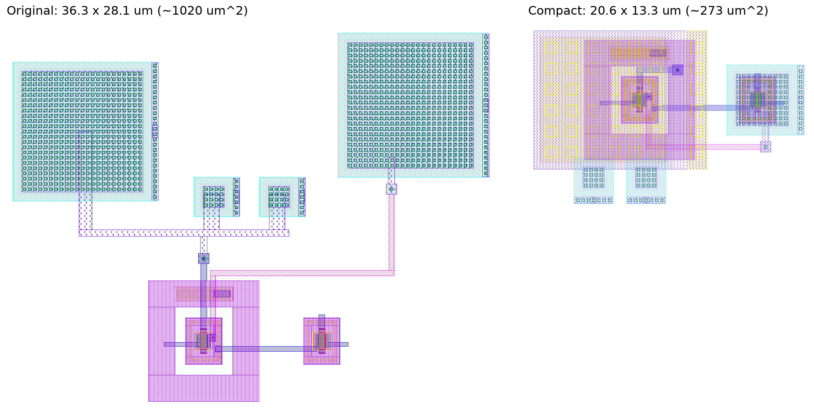

# FGFB-SKY130: a spiking neuron in one floating-gate, floating-body nMOS (SKY130, post-layout)

A single 5-V nMOS transistor in SKY130 with **two floating nodes** — a floating body (isolated p-well in a deep n-well, discharged by a second transistor) and a capacitively coupled floating gate — behaves as a programmable, multi-input spiking neuron.

All results here come **only from the open SKY130 foundry compact models and Magic-extracted layout parasitics**, simulated in ngspice. No behavioural macromodel, added bipolar device or fitted parameter is used. The impact-ionization physics is the BSIM4 substrate-current model already in the PDK.

**Author:** José Luis Valtierra Sánchez de la Vega ([@jlvsdlv](https://github.com/jlvsdlv))

This is released as-is, in the hope that someone with measurement access or TCAD picks it up. **If you use it, please [cite it](#how-to-cite).**



## Circuit

```
            Iin
             │
   Vmem ─────┼───────── Cmem (MIM) ── gnd
             │ drain
   FG ──────┤ M1  (nfet_g5v0d10v5, W/L = 1/0.5 µm, p-well in deep n-well @ 5 V)
   │         │ source → gnd        body ── M2 (nfet_g5v0d10v5, gate = VG2) ── gnd
   ├─ C_A ── VA   (input A)
   ├─ C_B ── VB   (input B)
   └─ C_fix ─ gnd
   V_FG = V_Q + β_A·V_A + β_B·V_B + β_D·V_mem ,  β_i = C_i / C_Σ
```

| Element | Value (model) |
|---|---|
| C_A = C_B | 8.5 fF (MIM 2×2 µm) |
| C_fix | 173 fF (MIM 9.6×9.6 µm) |
| C_mem | 188 fF (MIM 10×10 µm); 38 fF in the compact cell |
| β_A | ≈ 0.044 (1.8 V input step → 77–82 mV on FG) |
| Body capacitance (extracted) | ≈ 16.8 fF |

## Key results (extracted layout, tt, 27 °C, V_G2 = 0.5 V unless noted)

| Property | Result |
|---|---|
| Static hysteresis programmed by stored charge | trigger 5.38 → 4.26 V, release 4.45 → 3.73 V for V_Q = 0.40 → 0.55 V; loop unchanged for a 100× slower sweep |
| Spiking with constant input current | 85.4 kHz at V_Q = 0.45 V, 50 nA; V_mem 3.9–5.2 V |
| Firing band (shifted by V_Q) | ~10–50 nA (0.40 V), 25–100 nA (0.45 V), 50–150 nA (0.50 V); 11–210 kHz overall |
| Energy per spike | 2.5–4.6 pJ (I_in·⟨V_mem⟩/f) |
| Excitability class | Type II: finite-rate onset (≈9–15 kHz); subthreshold oscillation 0.14–0.58 V at ≈15 kHz just below onset (V_G2 = 0.4 V); periodic inputs entrain the output at f_in/3, f_in/4 |
| Weighted inputs (Poisson pulse trains on control gates, V_Q = 0.46 V, 20 nA, silent without input) | graded output; at ~159 kHz input: 7.9 / 13.8 / 18.1 kHz for 0.6 / 1.2 / 1.8 V pulses; two inputs (C_B = 2× area) obey r_out ≈ 0.079·(r_A + 1.5·r_B) − 1.2 kHz |
| Mismatch (Monte Carlo) | 24/25 samples fire at nominal bias, 77.8 ± 7.6 kHz |
| Corners / temperature | trimming V_Q (0.15–0.35 V for ff, sf, 85 °C; 0.45–0.55 V with V_G2 = 0.6–0.7 V for ss, fs, −40 °C) restores firing in all cases |
| Area | 36.3 × 28.1 µm (original); 20.6 × 13.3 µm = 273 µm² compact cell (C_fix on the 2nd MIM layer over the transistors), fires at 108.5 kHz |

Additional explored results (in `data/`): coupled-oscillator / Ising behaviour (two-phase sub-harmonic locking, anti-phase capacitive coupling, small max-cut graphs solved with the original cell), C_mem scaling, pulsed potentiation test.

## Limitations — please read

- The SKY130 impact-ionization parameters are extracted with a grounded body. Floating-body operation is an extrapolation of a calibrated model; **absolute trigger voltages/currents need measurement or TCAD confirmation**.
- The models contain no lateral bipolar transistor.
- Floating-gate programming (tunnelling / hot-carrier injection) is **not** modelled; V_Q is set in the test bench through a 1e18 Ω resistor (or an initial condition for the compact cell).
- Input weights are fixed by capacitor sizing; no synaptic plasticity was obtained from PDK physics (a Pazos-style pulsed potentiation test gave a single saturating ~5 % change).
- The membrane swings up to 5.2–5.9 V, at the edge of the 5-V device rating.
- The two-input test enlarged C_B in the extracted netlist (`netlists/pex_cinB2.spice`), not in a new layout.

## Repository layout

```
layout/original/   Magic scripts (gen/build/drc/pex), .mag cells, GDS, extracted netlists
layout/compact/    stacked-MIM compact cell (273 µm²), same flow
netlists/          flattened extracted netlists used by the simulations
                   pex_flat.spice (original), pex_cell.spice (as subckt), pex_cinB2.spice (C_B ×2),
                   pexc_flat / pexc_cell (compact), pex_cm*.spice (C_mem variants)
sim/               ngspice drivers and analysis (Python); lib.py is the common runner
data/              JSON/log results of every sweep reported above
figures/           figures (PDF/PNG)
docs/              manuscript drafts: 4-page letter (Springer sn-jnl) and longer article (Elsevier CAS)
```

## Reproducing

Requirements: ngspice ≥ 42, Python 3 with numpy/matplotlib, the SKY130A PDK built by open_pdks (for Monte Carlo use the open_pdks models, not the raw skywater-pdk repo), Magic ≥ 8.3.4xx for layout work (older Ubuntu packages cannot parse the current sky130A tech file).

```bash
export PDK_ROOT=/path/to/pdk   # directory containing sky130A/
export PDK=sky130A
cd sim
python3 -c "import lib; d=lib.run(0.45,0.5,'Vdrv vd 0 0\nIin vd vmem 50n',srcA='1.8',T=80e-6,maxstep=4e-9,ic=3.0); print(d[-1])"
```

`lib.run(V_Q, V_G2, drive, srcA, srcB, T, maxstep, ic, corner, temp, mc, seed)` builds a test bench around `netlists/pex_flat.spice` (the netlists are also copied into `sim/`). Output columns: t, V_mem, I(Vdrv), V_FG, V_body. Set `lib.HDR = lib.HDR.replace("pex_flat.spice","pexc_flat.spice"); lib.FGIC = True` for the compact cell.

Main drivers: `map.py`/`loops.py` (hysteresis), `ifc*.py` (firing bands), `onset.py` (excitability), `poisson.py` (weighted inputs; supports two inputs and netlist variants), `robust.py`/`trim*.py`/`vg2*.py` (corners, temperature, Monte Carlo), `cmem.py`/`compact.py` (area scaling), `lock.py`/`twocell.py`/`ncell.py` (oscillator locking, coupling, max-cut), `stp.py` (pulsed potentiation).

Note: scripts were written in a single working directory; some paths are relative and may need adjusting.

## Related work

- S. Pazos et al., "Synaptic and neural behaviours in a standard silicon transistor", *Nature* 640, 69–76 (2025).
- A. Bhattacharyya, J. Hasler, "A six-transistor integrate-and-fire neuron enabling chaotic dynamics", *IEEE TBioCAS* (2025).

## How to cite

**If you use this design, data or code — in a paper, thesis, tape-out or product — please cite it:**

> J. L. Valtierra Sánchez de la Vega, "FGFB-SKY130: a spiking neuron in one floating-gate, floating-body nMOS transistor (SKY130, post-layout)," GitHub repository, 2026. https://github.com/jlvsdlv/fgfb-sky130

```bibtex
@misc{valtierra2026fgfb,
  author       = {Valtierra S{\'a}nchez de la Vega, Jos{\'e} Luis},
  title        = {{FGFB-SKY130}: a spiking neuron in one floating-gate, floating-body {nMOS} transistor ({SKY130}, post-layout)},
  year         = {2026},
  howpublished = {GitHub repository},
  url          = {https://github.com/jlvsdlv/fgfb-sky130}
}
```

If you measure, extend or tape out this cell, I would be glad to hear about it — please open an issue or contact me via GitHub ([@jlvsdlv](https://github.com/jlvsdlv)).

## License

- **Software, scripts, netlists, data and documentation:** [Apache License 2.0](LICENSE). Redistributions must keep the copyright and the [NOTICE](NOTICE) file.
- **Hardware design sources** (`layout/`: GDS and Magic files): [CERN Open Hardware Licence v2 – Weakly Reciprocal](LICENSE-HARDWARE). Modified versions of the design that are distributed must be released under the same licence and keep the source location notice.
- The SkyWater SKY130 PDK is a separate work under its own Apache-2.0 license.
